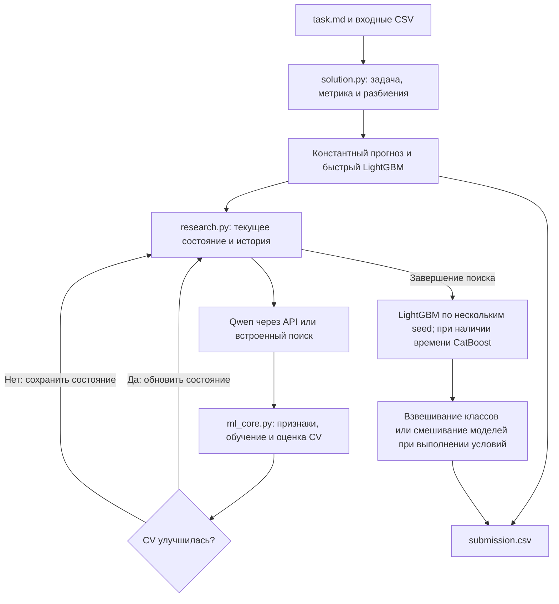

# autonomous-ml-agent

Прототип агента для табличного машинного обучения, подготовленный для кейса «AI-агент для разработки ML-моделей» хакатона «Альфа-Будущее» (октябрь 2026). Агент получает описание задачи и CSV, проверяет гипотезы по кросс-валидации и записывает прогнозы в `submission.csv`.

В кейсе описаны две публичные задачи: регрессия энергопотребления зданий с RMSE и многоклассовая классификация типов атак по табличным данным с Macro F1. Платформа также предусматривала две скрытые задачи. Регламент запуска задавал Python 3.12, 8 CPU, 32 GB RAM и до трёх часов на задачу.

## Архитектура



1. `solution.py` находит входные файлы, определяет таргет и тип задачи, убирает строки без ответа и исключает ID из признаков. Константный прогноз сохраняется первым, быстрый бейзлайн перезаписывает его при успешном обучении.
2. `pick_cv` выбирает разбиение по группам при низком пересечении групп, по временным блокам при обнаруженном сдвиге или обычный KFold либо StratifiedKFold. Временные блоки формируются на отсортированных данных и допускают обучение на более поздних строках.
3. `prepare` формирует признаки из дат, кодирует категории, извлекает длину и компактные текстовые признаки через TF-IDF и SVD, убирает константные столбцы. При подходящем ключе для регрессии и бинарной классификации проверяется target encoding внутри CV.
4. `research_loop` сравнивает кандидата с текущим лучшим результатом, обычно на пяти фолдах. Состояние включает параметры LightGBM, набор исключаемых колонок, преобразования признаков и опциональный логарифм таргета. Запасной поиск использует готовые гипотезы и случайные изменения параметров.
5. Финальный этап усредняет прогнозы по фолдам и доступным seed. При наличии времени пробует CatBoost и выбирает долю LightGBM на сетке 0–1 по общим OOF-прогнозам при достаточном покрытии. Для F1 отдельно оцениваются множители вероятностей классов. Файл обновляется атомарно. Модели остаются в памяти процесса.

## Роль Qwen

Настраиваемая LLM получает краткий профиль таблицы, описания полей, агрегаты по таргету, текущую конфигурацию и до 12 последних экспериментов. Она возвращает гипотезу в JSON. Python ограничивает набор изменений, обучает модели, вычисляет метрику и принимает гипотезу при улучшении выше порога. При `LLM_SPEC=1` добавляется разбор описания задачи моделью. Путь вывода задаёт код либо `OUTPUT_PATH`.

В исходной хакатонной версии исследовательский цикл мог исполнять сгенерированный Python через `exec`. В этой копии ответы LLM принимаются только как настройки LightGBM, предложение убрать столбцы или включить логарифмирование таргета. Генерация признаков запускает функции из репозитория.

## Стек

Python 3.12, NumPy, pandas, scikit-learn, LightGBM, CatBoost, OpenAI Python SDK для OpenAI-совместимого API. Qwen3.8-27B указан в ТЗ и в коде как имя модели по умолчанию, доступность зависит от провайдера. scikit-learn также предоставляет резервный HistGradientBoosting. XGBoost присутствовал в исходных зависимостях компактной версии. В расширенных исторических вариантах B–E он реализован как кандидат ансамбля. В этом репозитории используются LightGBM и CatBoost.

## Установка и запуск

Из корня репозитория в PowerShell:

```powershell
py -3.12 -m venv .venv
.\.venv\Scripts\python.exe -m pip install -r requirements.txt
.\.venv\Scripts\python.exe demo.py
$env:TIME_BUDGET_SEC = '90'
.\.venv\Scripts\python.exe solution.py demo-data/task.md
Import-Csv demo-data/submission.csv | Select-Object -First 5
```

Демо создаёт 400 обучающих и 80 тестовых строк. Для своей задачи положите рядом `task.md`, `train.csv`, `test.csv`, `sample_submission.csv` и, если есть, `data_dictionary.csv`. Первая колонка образца — ID из test; следующие описывают требуемый вывод. Запустите `python solution.py путь/к/task.md`. По умолчанию выходной CSV создаётся рядом с описанием. Для обычного запуска не задавайте `TIME_BUDGET_SEC` или верните его к 10800 секундам.

Для режима Qwen задайте в оболочке `LLM_API_KEY`, `LLM_BASE_URL` и `LLM_MODEL` по настройкам вашего провайдера. Поддерживаются соответствующие имена `OPENAI_API_KEY`, `OPENAI_BASE_URL`, `OPENAI_MODEL`. Файл `.env.example` перечисляет параметры. Код читает переменные процесса, автоматической загрузки .env нет. Для локального режима достаточно оставить API-ключ и адрес незаданными. Перед включением API проверьте, что описания полей и статистику разрешено передавать провайдеру.

## Результаты и ограничения

На синтетических данных из сохранённых прогнозов пересчитаны RMSE 0,59933 и Macro F1 0,58471 для A long, против 2,35689 и 0,25287 у простого ориентира. Это исторические тесты своих версий.

Для этой копии подтверждены синтаксис Python 3.12 и генерация синтетического входа. Сквозное обучение не проверено: в доступном Python отсутствует scikit-learn, загрузка пакетов прерывается. API Qwen не вызывался.

- Реализованы табличная регрессия и классификация. Выбор семейств моделей ограничен заранее заданным пайплайном. Многотаргетный сценарий, кластеризация, обнаружение аномалий и XGBoost относятся к другим снимкам разработки.
- Преобразования вроде частот и TF-IDF обучаются до CV на объединённых train/test признаках. Поиск ключа сущности использует все доступные метки перед внешним CV. Значение CV может быть оптимистичным при переносе на новые данные.
- Поиск многократно использует CV. Настройка класса или ансамбля на тех же OOF-прогнозах также способна завысить оценку. Дедлайн может сократить покрытие фолдов.
- На маленьких и сильно несбалансированных выборках пяти фолдов может оказаться слишком много. Эвристики типа задачи, метрики и временного сдвига требуют проверки для нового датасета.
- Исследования пишутся в stdout и хранятся в памяти, отдельного трекера экспериментов и экспорта обученной модели нет. Watchdog завершает процесс на 94% заданного бюджета, поэтому для крупных данных требуется достаточный запас времени.


